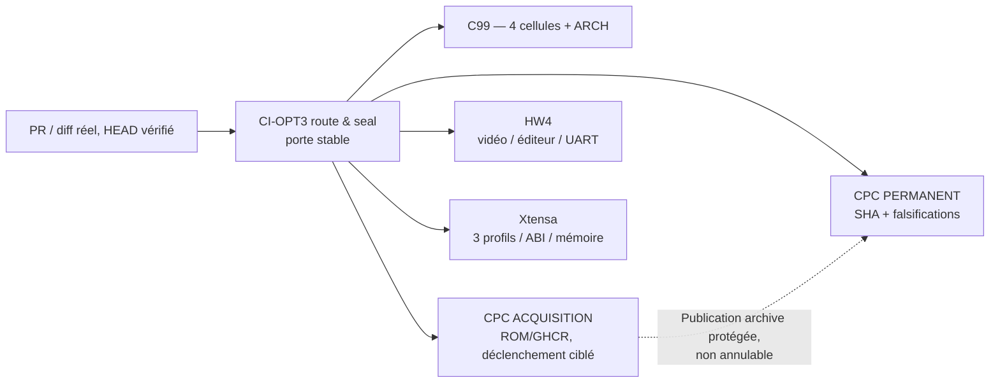

# CI-OPT3 — cinq familles fonctionnelles, routage et protection des oracles CPC

**Mandat :** [Pilotage #174](https://github.com/Kharn27/ESP32-Locomotive-Basic/issues/174), phases A/B autorisées après acceptation de [#172](https://github.com/Kharn27/ESP32-Locomotive-Basic/pull/172). **Base effective :** `main@86d04e69c9620a7825903e704d72041cf19a35d4`. **PR :** [#175](https://github.com/Kharn27/ESP32-Locomotive-Basic/pull/175). Aucun changement au moteur BASIC/firmware, aux snapshots ou aux sceaux SHA.

## Inventaire vérifiable, avant/après

La référence CI-OPT2 comptait **28 workflows** avant l'oracle E-A. Après la fusion #172, **29 fichiers `.github/workflows/*.yml`** existent dans `main`, incluant `j1-16-e-a-small-store.yml`. CI-OPT3 ajoute la porte stable `ci-opt3-routing.yml`, soit **30 fichiers**, répartis sans doublon dans les cinq propriétaires suivants :

| Famille | Fichiers de workflow | Preuve/sortie propriétaire |
|---|---|---|
| **C99** (3) | `basic-program.yml`, `ci-arch.yml`, **`ci-opt3-routing.yml`** | Matrice complète GCC/Clang × sanitizers OFF/ON, isolation ARCH et contrôle permanent du routage |
| **CPC permanent** (2) | `ci-cpc-permanent.yml`, `cpc-oracle.yml` | SHA scellés, falsifications, historique CPC ; oracle indépendant sous conditions de chemins |
| **CPC acquisition** (19) | `cpc-oracle-image.yml` et les 18 workflows `j1-*-a`, `j1-12-b1`, `j1-16-d-a`, `j1-16-e-a` détaillés ci-dessous | Nouvelle acquisition Caprice32 GHCR épinglé / ROM CPC historique ; seulement si mission et chemin pertinent, `workflow_dispatch` conservé |
| **HW4** (5) | `hw4-c3-b1-scroll.yml`, `hw4-c3-b2-scroll.yml`, `hw4-diag-a.yml`, `hw4-edit-p1.yml`, `hw4-ready-a.yml` | Vidéo/scroll/éditeur/UART, tests C99 et acquisition d'écran ciblés |
| **Xtensa** (1) | `ci-xtensa.yml` | Trois profils ESP-IDF v5.5.6, ABI, budgets, `one app_main` ; filtré par sources cible, build et `tools/ci/**` |

**Tous les 18 workflows CPC historiques conservés :** `j1-2-a-boundaries.yml`, `j1-3-a-subtraction.yml`, `j1-4-a-multiplication.yml`, `j1-5-a-division.yml`, `j1-6-a-mod.yml`, `j1-7-a-add-vars.yml`, `j1-8-a-sub-vars.yml`, `j1-9-a-binary-family.yml`, `j1-10-a-if-then.yml`, `j1-11-a-gosub-return.yml`, `j1-12-a-for-next-integer.yml`, `j1-12-b1-cpc-reacquire.yml`, `j1-13-a-integer-relations.yml`, `j1-14-a-if-inline-else.yml`, `j1-15-a-string-scalar.yml`, `j1-16-a-real5-scalar.yml`, `j1-16-d-a-negative-store.yml`, `j1-16-e-a-small-store.yml`.

La classification est **conceptuelle**, sans remplacer les workflows d'oracle existants par un simulateur. Le script `tools/ci/opt3_routing.py` lit et audite les véritables fichiers YAML ; il vérifie leur propriétaire, les filtres, les dépendances E-A/D-A, les chemins source/archive, et rejette toute apparition d'un 31e workflow non intégré. La porte `CI-OPT3 five-family routing gate` reste **toujours déclenchée** sur les PR et sur `main`.

## Routage avant/après et garanties

| Modification | Avant CI-OPT3 | Après CI-OPT3 / protection |
|---|---|---|
| `docs/ROADMAP_GATES.md` uniquement | Les vieilles acquisitions J1.3/4/5 étaient déclenchées, et les 12 historiques sans filtre généraient des `SKIPPED` | **Aucune acquisition historique déclenchée** ; C99, ARCH et CPC permanent continuent ; porte stable |
| `core/basic_executor.c` | C99 / CPC permanent / ARCH / Xtensa, parfois jobs historiques `SKIPPED` | C99 / CPC permanent / ARCH / Xtensa **préservés** ; comparateur CPC indépendant toujours routé |
| `video/cpc_video.c` | C99/ARCH/CPC permanent/HW4/Xtensa | Tous conservés ; pas d'acquisition ROM historique étrangère |
| `firmware/esp32_display_probe/main/hw4_c2_console.c` | Xtensa et HW4 concernés | Xtensa + HW4, C99/ARCH/CPC permanent conservés |
| `tools/j1_16_e_a_store.py` | E-A dédiée événement PR, jobs parfois `SKIPPED` hors branche mission ; permanence toujours exécutée | **E-A dédiée déclenchable** avec filtre spécifique, `workflow_dispatch` conservé ; **CPC permanent toujours exécuté** et fail-closed |
| `tests/fixtures/cpc6128/j1_16_e_a_small_store/**` | Archive scellée, fraud detection | E-A dédiée + CPC permanent; SHA externes inchangés, falsification coordonnée refusée |
| Script E-A **et** fenêtre modifiés simultanément | Chaîne archive/manifest susceptible d'attaque si l'on retire le sceau | Routage E-A et permanence conservés ; indépendance du sceau vérifiée par self-test |
| `CMakeLists.txt` racine | Matrice C99, HW4 et Xtensa | Tous préservés ; le routeur prend en charge le `**/CMakeLists.txt` racine |
| Outil `tools/ci/**` | Xtensa déclenché | Toujours Xtensa, plus garde route sur PR |
| SHA HEAD mensonger | Scripts historiques protégés ponctuellement | La porte stable rejette `OPT3_HEAD_MISMATCH` ; oracle E-A conserve sa propre défense `EXPECTED_HEAD_MISMATCH` |

**Modifications apportées :** filtres de chemins additifs sur douze acquisitions anciennes jusqu'alors inconditionnelles ; suppression du seul déclencheur générique `docs/ROADMAP_GATES.md` pour J1.3/4/5. Les tâches capables d'archiver conservent `cancel-in-progress: false` et sont sérialisées par identité de PR sans `github.sha`, afin d'éviter d'interrompre une capture en cours. Les garde-fous de branche, de HEAD exact, de référence ROM, de conteneur GHCR et de publication conditionnelle **n'ont pas été modifiés**.

Le simulateur de routage vérifie **neuf scénarios** positifs/négatifs distincts ainsi que les liens dédiés D-A/E-A et le refus de promouvoir un oracle non enregistré. Un script `tools/j1_99_unknown_oracle.py` ne reçoit **pas** arbitrairement une preuve CPC. Le contrôle fail-closed `ci-cpc-permanent.yml` reste inconditionnel à chaque PR ; l'absence d'exécution d'une acquisition spécialisée est enregistrée `SKIPPED` ou `NOT_TRIGGERED`, jamais `SUCCESS`.

## Sceaux historiques et correctif C1

Aucun fichier `tests/fixtures/cpc6128/j1_16_e_a_small_store/**` ni `tools/j1_16_e_a_store.py` n'est modifié. La CI permanent exécute bien les deux archives D-A/E-A avec `--permanent --self-test` (six fenêtres E-A et quatre fenêtres D-A, ancrages SHA externes). Le nouveau routeur exécute **en plus** ces deux contrôles réels en host Python, y compris : falsification coordonnée rejetée par `SEALED_E_A_ARCHIVE_MISMATCH` / `SEALED_D_A_ARCHIVE_MISMATCH` et voie `STORE_UNVERIFIED` C1 conservée, sans `TypeError`. Les magasins CPC observés restent exactement `A=0: 00 00 00 00 00`, `A=1: 00 00 00 00 81`, `A=-1: 00 00 00 80 81`, sans intégration native.

Les workflows filtrés passent uniquement leur contrat de **déclenchement** ; une exécution historique dont le job est limité à une autre branche est distinguée d'une acquisition Caprice32 effectivement réalisée. Les captures sur HEAD exact sont exigées pour toute nouvelle mission oracle.

## Required checks / protection main

Inspection GitHub du 29 octobre 2026 : aucun `ruleset` actif visible sur l'API du dépôt, et `main` non marqué `protected`. Il n'existe donc pas de liste de `required checks` vérifiée comme obligatoire par protection native. Néanmoins, CI-OPT3 crée un **job stable toujours déclenché**, et conserve C99, ARCH et CPC permanent **sans filtre**. Toute évolution ultérieure des règles de protection est une décision Pilotage.

## Mesures GitHub Actions — protocole et réserves

**Population pré-CI-OPT3 mesurée :** 20 HEADs de PR distincts avec workflow `CI-C99 portable Linux 4 cells` terminé `SUCCESS`, sélectionnés par ordre d'activité descendante depuis les pages 1–15 de `GET /repos/Kharn27/ESP32-Locomotive-Basic/actions/runs?per_page=100&page=N`, avant PR #175. Les 20 IDs : `40921214206`, `40919647970`, `40918602480`, `40918535166`, `40918505229`, `40917684913`, `40917057424`, `40914948339`, `40914655484`, `40914182587`, `40911969432`, `40911153325`, `40910778520`, `40910360975`, `40907439442`, `40907202069`, `40906854820`, `40906633033`, `40903964637`, `40902075537`.

**Métrique préliminaire, C99 uniquement :** durée `updated_at - created_at` des runs GitHub terminés (inclut en principe délais globaux et actualisations du run, et n'est **pas** l'équivalent d'un découpage fiable des temps en file, du démarrage des jobs ou de leurs reruns). Méthode de percentile : rang le plus proche `ceil(p×N)`, données classées, N=20.

| Avant CI-OPT3 / C99 seul | Résultat observé |
|---|---:|
| P50 de durée run | **1,25 min** |
| P95 de durée run | **3,82 min** |
| Maximum échantillon | **5,13 min** |

**Après CI-OPT3 :** moins de 20 HEADs de PR indépendants disponibles pendant cette livraison. **P50/P95 comparatifs après, queue/rerun détaillés et réduction globale de latence : `NOT_YET_ESTABLISHED`.** Ne pas extrapoler les 20 mesures historiques C99 en une preuve de gain du chemin critique de toute la PR. L'objectif indicatif de validation ordinaire sous cinq minutes **n'est pas revendiqué comme atteint**. La durée d'une acquisition ROM fraîche ne fait pas partie d'un SLA PR ordinaire.

## État avant décision Pilotage

La vérité est celle des runs GitHub effectués sur **le HEAD exact de la PR #175** (à compléter dans la REMISE DÉVELOPPEUR). Vérifier en priorité : routeur stable, C99 quatre cellules, CPC permanent (avec D-A/E-A/C1), ARCH et Xtensa trois profils car `tools/ci/**` a changé. Ne jamais convertir un workflow filtré ou un sous-job `SKIPPED` en `SUCCESS`.

**Aucun changement de `core/`, `firmware/`, `io/`, `hal/`, `video/` ni archives scellées.** Aucune autorisation J1.16-E-B/J1.17. PR soumise exclusivement à la revue et à la fusion du Pilotage.
