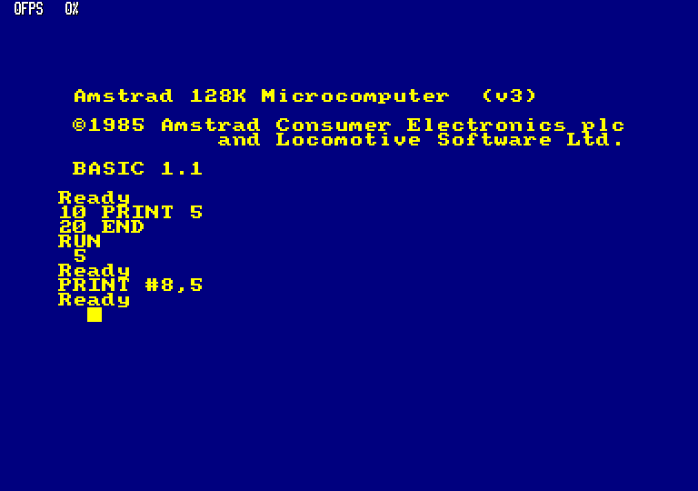
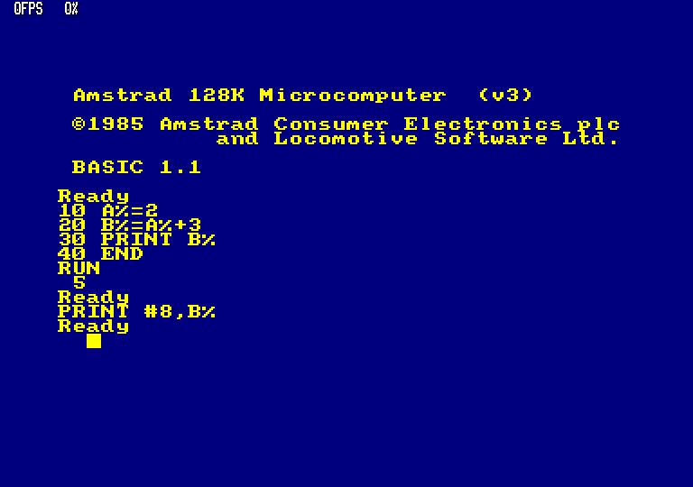

# J0.24-C2 — Preuves CPC 6128 archivées durablement

**Date :** 25 octobre 2026. **Statut :** deux preuves indépendantes conservées dans Git, sans clôturer J0.24.

Ce répertoire archive sans retouche deux captures produites par la ROM CPC6128 sous **Caprice32 4.6.0**, révision `8c778bf072a06fb7c23b9cccd179041db7f79a52`. Le commit Git de ce dépôt contient les octets PNG originaux. Aucun flux `PRINT` écran byte-à-byte n'a été collecté.

## Captures historiques — consultables directement sur GitHub

### 1. Programme minimal



[PNG brut](../tests/fixtures/cpc6128/evidence/caprice32/minimal/screenshot_20261025_153526.png) · [Sonde imprimante brute](../tests/fixtures/cpc6128/evidence/caprice32/minimal/printer.dat) · [stdout C99 brut](../tests/fixtures/cpc6128/evidence/caprice32/minimal/native.stdout.bin) · [Trace de saisie](../tests/fixtures/cpc6128/evidence/caprice32/minimal/autocmd.json)

```basic
10 PRINT 5
20 END
```

Capture PNG SHA-256 : `f1f6c19632305d30c3584b602eefa053010521d927eebc86ec86b5fdfad236d6`.

### 2. Programme témoin INTEGER



[PNG brut](../tests/fixtures/cpc6128/evidence/caprice32/witness/screenshot_20261025_153527.png) · [Sonde imprimante brute](../tests/fixtures/cpc6128/evidence/caprice32/witness/printer.dat) · [stdout C99 brut](../tests/fixtures/cpc6128/evidence/caprice32/witness/native.stdout.bin) · [Trace de saisie](../tests/fixtures/cpc6128/evidence/caprice32/witness/autocmd.json)

```basic
10 A%=2
20 B%=A%+3
30 PRINT B%
40 END
```

Capture PNG SHA-256 : `d0d15378eee3eb763390c1e0e592730e9260c0dcc6d7c832bcc7212d50e625b1`.

## Provenance et interprétation

Source exacte : [GitHub Actions #40207538056, artefact #12604041942](https://github.com/Kharn27/ESP32-Locomotive-Basic/actions/runs/40207538056/artifacts/12604041942) ; acquisition horodatée `2026-10-25T15:35:23.320596+00:00`. Le manifeste original est contrôlé par SHA-256 `d5f1aa9b3b8129d25db5511af164db9a32a6cad6232127ae3fc30b5429ab9d55`. Chaque PNG a été contrôlé par SHA **avant import**. L'import a été exécuté par le workflow temporaire de la PR #34, retiré après succès.

**Machine :** CPC6128, 128 Kio, clavier anglais, ROM système SHA-256 `31c3668c67bea027dab698ece233c9434d9324f9ba7dac84db58f400b6689562`, AMSDOS SHA-256 `ea65e0fb44ee93ede4b6c507509b7e5ddf497fb7155023bea91ef229469fa04d`. Les captures affichent `BASIC 1.1`, les programmes saisis, `RUN`, puis `5`. Configuration originale, journal Caprice32 et stderr natif sont également archivés.

| Canal | Octets originaux | Portée |
|---|---|---|
| Image CPC | PNG 768 × 540 | Témoin visuel de `RUN`, pas ASCII `PRINT` |
| `printer.dat` | `20 35 20 0D 0A` | `PRINT #8,5` ou `PRINT #8,B%` direct **après RUN** |
| `native.stdout.bin` | `35 0A` | `PRINT` C99 depuis une exécution indépendante |

**Comparaison admissible : `MATCH_SEMANTIC` pour l'unique entier 5.** Ni `MATCH_EXACT`, ni équivalence démontrée des deux formats imprimante/écran. Les 21 expériences du manifeste historique [J0.24](../tests/fixtures/cpc6128/manifest.json) restent sans observations officielles ; l'acceptation exige encore **au moins huit cas indépendants et deux images tokenisées CPC**.

## Contrôles et droits

```sh
python3 tools/cpc_evidence.py --self-test
cmake -S . -B build
cmake --build build --parallel
ctest --test-dir build --output-on-failure
```

Le vérificateur contrôle les tailles, SHA-256, chemins, formats, rôles des fichiers, sources, traces de saisie et assertions sémantiques ; ses cinq tests négatifs couvrent notamment falsification, traversée de chemin, extension ROM et confusion de canaux. Il ne dépend ni de Caprice32 ni des ROM. La CI portable passe de 21 à **22 suites**, sans modification du cœur C99.

**Droits :** le code Caprice32 est sous GPLv2, mais les ROM `rom/*` de l'amont sont classées « Commercial / TODO » par `debian/copyright`. Les PNG ne sont **pas** des ROM ni des snapshots contenant la ROM : ils documentent un comportement observable à des fins de test d'interopérabilité. La publication de ces courts extraits visuels ne constitue pas une autorisation générale de redistribution du contenu Amstrad/Locomotive ; les titulaires conservent leurs droits. Aucun dump ROM, `.rom`, `.sna`, disque protégé ni copie de la ROM n'a été ajouté au dépôt parent. En cas de réclamation, le retrait des captures et la conservation du manifeste SHA/protocole restent possibles.

**Limites :** 2 cas sémantiques seulement, aucune donnée tokenisée, aucun stdout CPC écran binaire ; il ne faut pas déclarer J0.24 terminé. La génération normale de nouveaux artefacts Caprice32 est inchangée.
**CI C99 indépendante du CPC :** [run #40212409439](https://github.com/Kharn27/ESP32-Locomotive-Basic/actions/runs/40212409439), **22/22 Linux standard et 22/22 ASan/UBSan**. Les 21 suites précédentes restent inchangées. Le workflow oracle [cpc-oracle.yml](../.github/workflows/cpc-oracle.yml) n'a pas été modifié ; il conserve la régénération séparée d'artefacts, sans comparaison binaire de PNG entre runs.
